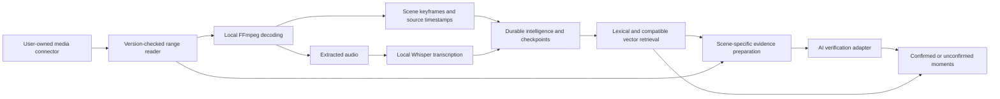

# Brisky: technical design and engineering decisions

Updated 2026-10-27. This document explains the current implementation and intended advantages;
it does not claim that production accuracy, latency or cost targets have been achieved.
For event attribution, see [the existing-product baseline and hackathon contributions](hackathon-contributions.md).

## Product objective and decision order

Brisky helps a user find a specific moment in their video library from a description, including
spoken phrases, visible details and action sequences. A plausible topic match is not sufficient when
the request depends on a small object, color, relationship or order of events.

Our decision order is **accuracy first, then cost, then speed**. We prefer an honestly unconfirmed
result over a cheap false confirmation. Among configurations meeting the measured accuracy requirement,
we choose the lower-cost option, then optimize latency. Local compute still consumes time, electricity
and hardware capacity; zero API charges do not make it free.

Accuracy includes candidate recall, correct confirmation, correct timestamps and honest uncertainty.
It cannot be established from unit tests or model confidence alone. The labelled experiment in
[the accuracy/cost audit](hackathon-cost-accuracy-audit.md) is still required before publishing quality claims.

## System shape

This is the principal source/verification flow, not a claim that every stage is concurrent or streamed.
Small-source fallback downloads and the existing whole-video model pass are described below.

## Why each component exists

| Component or workflow | Design reason | Intended advantage | Cost, limitation or validation boundary |
| --- | --- | --- | --- |
| FFmpeg / FFprobe | Decode container formats, inspect timelines and extract actual frames/audio locally | Deterministic media operations need no multimodal API call; the decoder chooses correct seek offsets | CPU and decoder memory still matter; source codec/GOP/layout affect work |
| Whisper | Obtain searchable speech locally | Reduce remote inference dependence while retaining word/phrase evidence | Real speech quality and window-boundary behavior require evaluation; model initialization is a real cost |
| PostgreSQL + pgvector | Keep ownership, timestamps, observations, checkpoints and searchable vectors together | Durable retrieval and resumable work, with lexical fallback when semantic retrieval is unavailable | Query and corpus vectors must use the same model/space; a provider swap does not automatically make old vectors compatible |
| Redis + BullMQ | Separate interactive API work from background jobs and retain retry state | Bounded scheduling, retries and completed-unit reuse | Asset-wide locking currently serializes jobs for one video; parallel workers are not unrestricted per-video parallelism |
| Storage connectors | Resolve media through the owner's account instead of copying the archive into Brisky permanently | Storage-provider independence and explicit ownership boundaries | Google Drive is the implemented cloud adapter; a common interface does not imply every provider exists |
| Provider-neutral AI boundary | Keep provider SDKs out of application decisions | Swap adapters without rewriting search orchestration; prepare for future developer-supplied keys | Google is active; dormant Meta adapter has offline interface tests only. Live Meta inference and developer BYOK behavior remain unvalidated/unimplemented respectively |
| Evidence-sensitive verification | Check the actual scene against the original query constraints | Reduce false confirmations from broad captions or embeddings | Missing evidence, inference failures and evaluated negatives remain distinct |
| Durable completed checkpoints | Remember work that has actually finished and passed validation | Avoid repeating completed preparation and model work after interruption | Checkpoint reuse must match source version and policy; per-window coverage is still being extended |

FFmpeg, Whisper, cloud indexing, retrieval and the dashboard predate the event. The contribution is
the newly documented orchestration, evidence handling, budget/recovery work and additional functionality
listed in the contribution record, rather than authorship of those underlying tools.

## Streaming: what it means and what it does not mean

A download arriving as a stream can still wait until the entire file is on disk before decoding.
Brisky now also provides a private loopback endpoint from which FFmpeg requests source byte ranges.
The reader fetches bounded blocks, validates HTTP status, Content-Range and actual body length,
and forwards data with backpressure. FFmpeg interprets the container and its indexes; we removed
the earlier average-bitrate approximation because timestamps cannot safely be inferred from file size.

The intended benefits are earlier decoding and less temporary original-video storage. Streaming does
not eliminate network transfer: full scanning may read most or all of a video, and repeated seeks can
transfer bytes again. The reader counts repeated reads toward its allowance.

Scene/audio source preparation and selected-moment inspection use validated sessions when supported.
Small cloud sources may use one bounded download shared by candidates in a search. The current
whole-video multimodal upload and on-demand full proxy generation still need a complete local source.
We retain whole-video reasoning rather than silently remove context merely to lower cost.

The reader validates source size/version again after decoding. An observed source change rejects the
output. This is a consistency check, not an immutable provider-revision snapshot. See the detailed
[reader limits and native tests](seekable-cloud-media.md) and [indexing execution boundaries](streamed-indexing.md).

## Simultaneous processing is bounded and explicit

Network reading and FFmpeg decoding can overlap. Individual decoder readers allow bounded concurrent
HTTP requests; extraction scheduling and worker slot limits constrain heavier work. Independent assets
can use available worker slots, while the current asset lock protects one video's mutation/checkpoint state.
This prevents duplicate work and conflicting writes at the cost of less per-video parallelism.

Opt-in resumable audio windows now allow one window to be transcribed while at most one following
window is extracted. One local Whisper process is reused for the job, and each published window has
an atomic transcript/checkpoint commit. A retry skips completed windows. This is not unrestricted
simultaneous scene, audio, embedding and AI work. The audio feature remains disabled by default until
speech-boundary accuracy is measured. Opt-in scene preparation now checkpoints bounded windows and
adds evidence intervals spanning artificial boundaries; downstream jobs still wait for scene preparation.
Scene-boundary accuracy and additional analysis cost remain unmeasured. See
[resumable audio details and tradeoffs](resumable-audio-windows.md).
See also [resumable scene preparation](resumable-scene-windows.md).

## Retrieval is a shortlist, not proof

Lexical and compatible semantic retrieval produce candidate moments. Detail/temporal requests preserve
the original constraints even if query understanding rewrites a retrieval phrase. Candidate expansion
can inspect beyond the first batch within explicit limits.

Scene-specific frames support visual detail checks; actual short clips support order/sequence checks.
An asset cover thumbnail is not substituted for missing scene evidence. Prepared evidence records its
source kind and timestamps. Preview pixels cannot recover detail absent from the preview, and sparse
sampling cannot guarantee every fleeting event is captured.

Only a valid, evaluated positive response becomes a confirmed match. Operational errors and insufficient
evidence do not become negative findings. Retrieval scores and model confidence are not calibrated
probabilities. Cache identity includes query constraints, evidence bytes/timestamps, model policy and
source kind, and cached timestamps must agree with fresh results.

## Cost controls and model placement

Local decoding, transcription, deterministic parsing, retrieval and completed-cache reuse reduce the
work sent to a remote model. The intended Meta role is reasoning over ambiguous requests and/or checking
retrieved scene evidence, where a model can materially change the result. **A dormant Meta adapter
now has offline request/response tests, while Google remains active at the owner's request.
No live Meta inference or accuracy validation is claimed.** See [adapter scope](meta-adapter.md).

Remote generation/embedding attempts require an explicit allowance, model pricing and a durable
reservation before each attempt. Unknown/failed/in-flight usage retains its reservation rather than
being recorded as free. Output caps, bounded retries and deadlines limit work; provider cancellation
is best effort and may not prevent billing. The ledger is a local/shared-filesystem admission mechanism,
not a guaranteed provider billing cap or a proven multi-host budget service.

The initial live pilot allowance is $3, within the hackathon's $150 credits. Pricing is not yet configured
for live inference. No API spending is required for the local synthetic decoder/protocol checks.
See [budget controls](ai-budget-controls.md) for exact scope and settings.

## Speed and recovery are part of correctness

The UI first displays provisional candidates, then requests verification. It preserves useful results
when checks are incomplete and offers deliberate continuation. It does not interpret a timeout as proof
that an event is absent. New searches cannot be overwritten by older responses.

Search disconnects/deadlines propagate to inference, extraction and search SQL where supported.
Database cancellation uses separate capacity and holds a connection out of reuse until cancellation
finishes. Background worker cancellation currently has coarser stage boundaries; that distinction remains
documented rather than hidden. See [search recovery](search-recovery-ux.md).

## Evidence for judges

| Claim | Current evidence | What it does not prove |
| --- | --- | --- |
| Decoder-driven seeking preserves the tested interval | Real FFmpeg comparisons with local decoding, VBR/long GOP fixtures, MP4 metadata at either end, all-frame comparisons | Accuracy/performance across arbitrary production media |
| Streamed scene/audio preparation is wired into jobs | Worker fixtures, real decoder scene/audio tests and source/version checks | Live authenticated Drive behavior or a production throughput target |
| Checkpoints are durable and retries reuse completed work | Disposable PostgreSQL insert/update/load checks; retry and inline-frame fixtures | Exactly-once inference across every crash point or global multi-host billing admission |
| Search recovery retains useful results and owner boundaries | API/database/HTTP-disconnect tests with synthetic accounts/data | A finished live browser assessment or full security audit |
| Better accuracy at acceptable cost | Evaluation protocol exists; measurements are pending | Any published accuracy percentage, pennies-per-hour claim or guaranteed speedup |

Reproducible commands and test scope are linked from the implementation documents. Before submission,
pin model/version and commit, use permissioned footage and publish the actual demo contribution boundary.
Report precision/recall, absent-query false confirmations, timestamp error, incomplete rates, total
attempts/downloaded bytes, measured API charges and cold/warm latency together. A fast result is not
successful if it confirms the wrong scene.

For deployment limitations and the developer-consumer roadmap, see the
[API and ingestion readiness review](api-and-ingestion-readiness-review.md). It also records the
remaining full-download paths and the unproven retrieval contribution of the split whole-video pass.

[Durable clip operations](clip-operations-api.md) document the new developer-facing export lifecycle:
keyed requests, recovery across queue acknowledgements, owner-scoped status and atomic result publication.

[API contract and usage semantics](api-contract-and-pagination.md) explain cursor precision, bounded
reads, public failure states and why unmeasured costs/cache-hit rates are reported as unknown.
